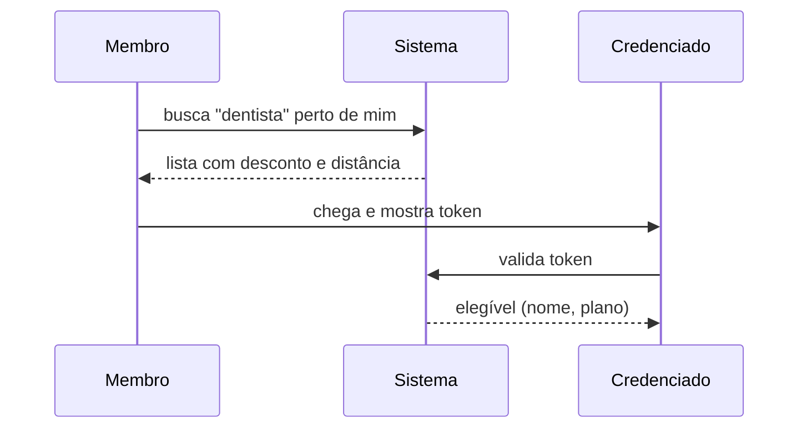
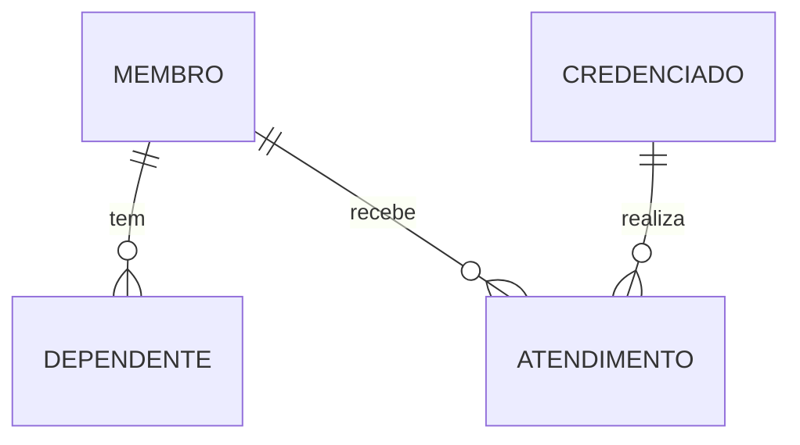
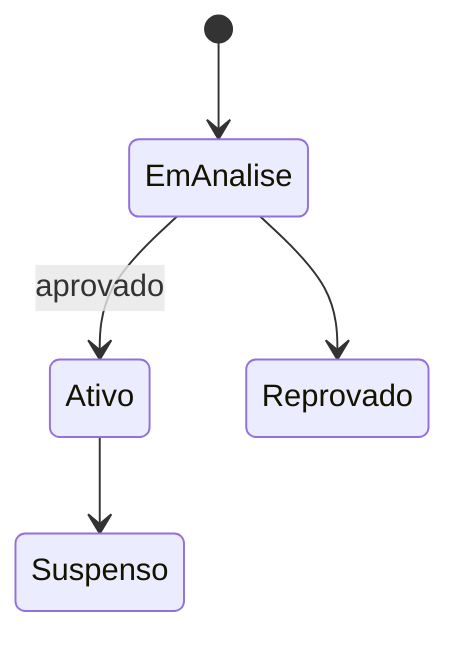

# Modelos dos documentos do plano (docs/plano/)

Curtos. Se um documento passar de 2 telas, resuma e mova detalhes para anexos.

## VISAO.md
```
# Visão
Problema (1 frase):
Para quem (perfis): …
Objetivo e métrica de sucesso: … (ex.: 50 credenciados ativos e 1.000 membros em 6 meses)
MVP (primeira versão): • … • …
Depois: • …
Fora de escopo: • …
Premissas [premissa]: • …
```

## FLUXOS.md
Uma seção por jornada: `## Membro encontra um credenciado e é atendido`, passos numerados e um diagrama:


## DOMINIO.md


Regras: `R1` texto da regra · origem (quem disse) · como testar.

## INTEGRACOES.md
| Integração | Gatilho | Entrada | Saída | Se falhar |
|---|---|---|---|---|

Fluxo n8n: `[nome]` gatilho → passo → passo → resultado · onde fica a regra · experimento que provou (H#).

## RISCOS.md
| # | Hipótese/risco | Como testar | Critério de sucesso | Situação |
|---|---|---|---|---|

## ROADMAP.md
`M0 laboratório` (protótipo + experimentos) · `M1 MVP` (lista de funcionalidades + critério de pronto) · `M2 …`

## EXPERIMENTOS.md
`### H1 …` hipótese · como testei (pasta laboratorio/…) · resultado e evidência · decisão (mantém/muda o plano).
